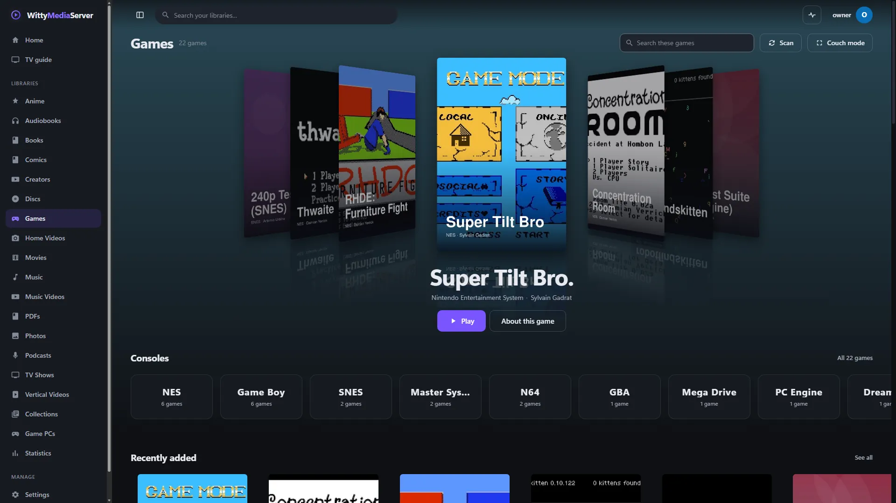
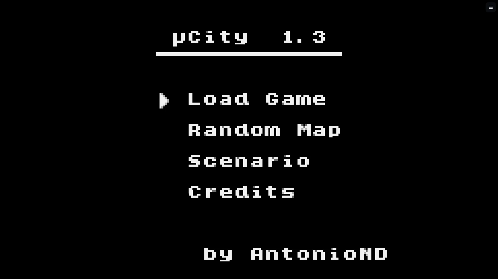
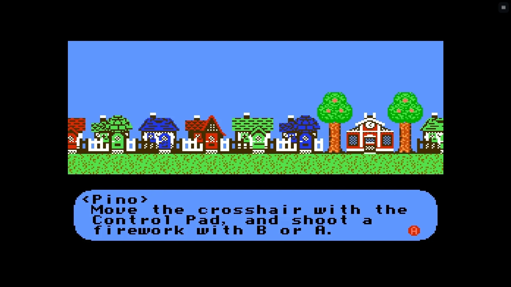
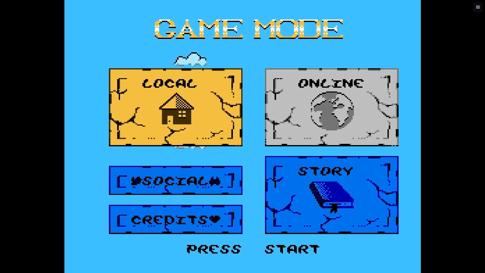
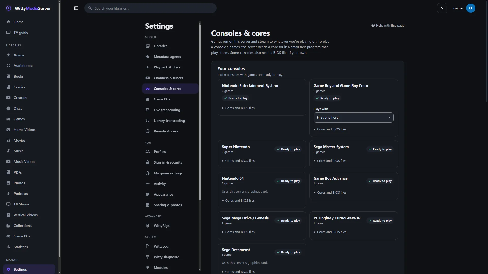
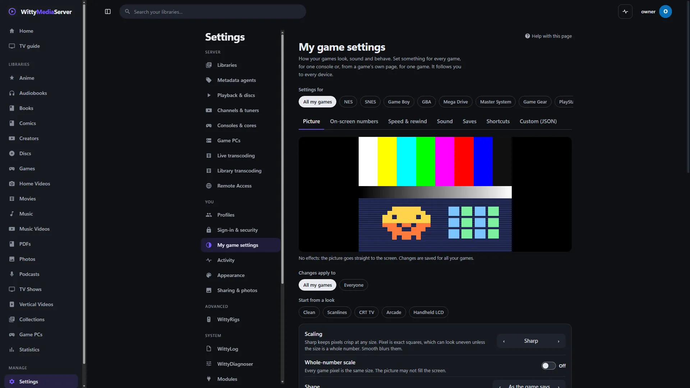
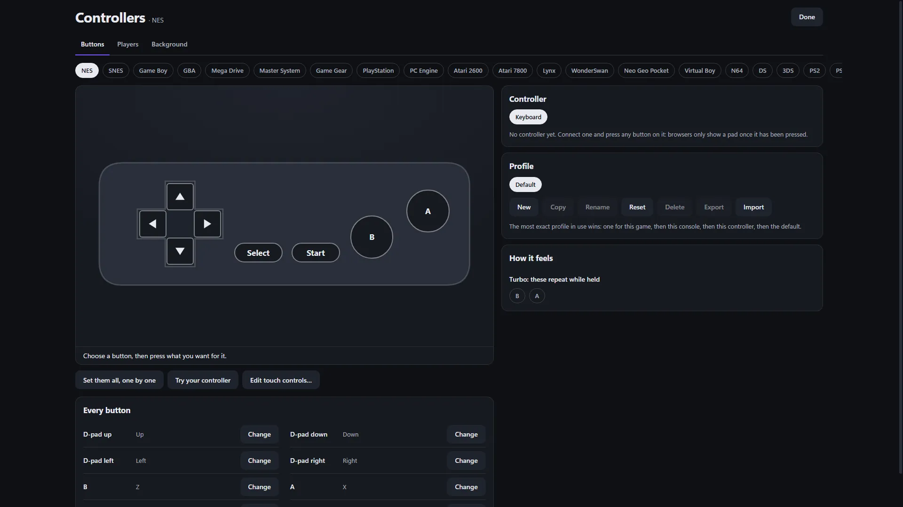

# WittyPlay

Plays console games from WittyMediaServer on any screen with a browser or a client app. You need it if you want a games library. Each game runs on the server, in its own sandboxed process, and its picture and sound stream to you.

<!-- pictures -->



<sub>A games library of open-licence homebrew. From a test server. The server's [credits list](https://github.com/wittywilla/WittyMediaServer/blob/master/docs/images/CREDITS.md) names everything shown.</sub>



<sub>[µCity](https://github.com/AntonioND/ucity), Antonio Niño Díaz, GPL-3.0-or-later and CC BY-SA 4.0, running on the server and streamed to a browser.</sub>



<sub>[Thwaite](https://github.com/pinobatch/thwaite-nes), Damian Yerrick, GPL-3.0-or-later.</sub>



<sub>[Super Tilt Bro](https://github.com/sgadrat/super-tilt-bro), Sylvain Gadrat, WTFPL.</sub>



<sub>Settings, Consoles & cores, in WittyMediaServer.</sub>



<sub>Settings, My game settings, in WittyMediaServer.</sub>



<sub>Setting up controllers, in WittyMediaServer.</sub>

<!-- /pictures -->

## What it does

- **Runs games through libretro cores,** one separate runner process per game, boxed in before it loads a core.
- **Streams over WebRTC,** with fallbacks over WebSocket where that can't work. FFmpeg encodes.
- **Every controller:** gamepads, keyboard and touch, with remapping and a touch layout editor.
- **A game menu and picture effects,** rewind, cheats, and IPS and BPS patches applied to a copy.
- **Sorts games into consoles** from their files, with the settings for each console and core as data.
- **Refuses encrypted game files** with a clear message, such as encrypted 3DS files. Nothing is decrypted.
- **Optional: standalone emulators.** PCSX2, Dolphin, PPSSPP, melonDS, Flycast, xemu, Cemu and RPCS3, downloaded from their own projects with the licence shown first, each run one per game on the server's own desktop in its system's sandbox (macOS, Windows), in a bubblewrap sandbox (Linux), or in a hardened Docker container, and streamed over WebRTC. Every one of each emulator's settings, from its own configuration, in the web pages; every player's controller written into its own settings. Off by default; libretro cores always stay in the process sandbox; no emulator, game, BIOS or key is bundled, and no Switch emulator is offered. See [docs/STANDALONE-EMULATORS.md](docs/STANDALONE-EMULATORS.md), [docs/DOCKER-BACKEND.md](docs/DOCKER-BACKEND.md), and what plays on which server in [docs/PLATFORMS-AND-PLAN.md](docs/PLATFORMS-AND-PLAN.md).
- **GameCube, Wii, Wii U, PlayStation 3, Xbox and Switch** are consoles of the library, recognised from their files' own bytes: GameCube and Wii on Dolphin's libretro core, the others in a standalone emulator.

The games library, its metadata and where saves are kept stay with the server.

No games, ROMs, BIOS files or cores come with it. Bring your own games, and add cores in **Settings → Consoles & cores**. Non-commercial cores are never offered. Games can contain flashing images.

How to use it is in **Help** inside WittyMediaServer: see Games.

## How to get it

An admin adds it from the module store inside WittyMediaServer: **Settings → Modules**, then **Browse the store**, then **Add** beside WittyPlay. That needs WittyMediaServer 0.6.0-alpha or later, and it works with nothing older. The range this version fits is in `module.json`: 0.8.0-alpha through 0.8.x, as it carries module API 4.

## What it needs

- FFmpeg, which comes with the server.
- Game cores, which you add in **Settings → Consoles & cores**. Some consoles need BIOS files of your own too.
- It asks the server for four permissions: network, running programs, devices, and data.

It's built on pion/webrtc, coder/websocket and ebitengine/purego, plus [WittyModule](https://github.com/wittywilla/WittyModule), all built in. It's written in Go with no cgo, and the player in `web/` is React.

## Platforms

A program is built for each system below, and the server uses the right one.

| System | Where it stands |
|---|---|
| Linux (x64, arm64, 32-bit ARM, x86) | Its tests pass on x64, and a game has played in a browser from a test server with it installed. The other CPUs are only built |
| Windows (x64, arm64) | Built. This version hasn't been run on Windows since it became its own program |
| macOS (Intel, Apple silicon) | Run on an Apple M3 Pro (macOS 27): games from the owner's own library stream from a test server, and consoles drawn on a graphics card use the Mac's own (below). Intel Macs are only built |
| FreeBSD (amd64, arm64) | Cross-compiled only. It has not been run |

On macOS and FreeBSD the server has no sandbox for a module's helper: it gets a small environment and a soft memory limit, and nothing more.

### A Mac's graphics card

The runner makes an OpenGL 4.1 context with CGL on a Mac's graphics processor. On an Apple M3 Pro, played end to end through a test server with the owner's own games (60 frames a second is full speed):

| Console, game | Core | Frames a second | Runner's processor use |
|---|---|---|---|
| PSP, God of War: Ghost of Sparta, 960x540 | PPSSPP, OpenGL | 60 after it loads | 15 to 27% of a core, against 3 to 5 cores with PPSSPP's own software renderer |
| PlayStation, Final Fantasy VII | SwanStation, OpenGL | 59.9 | 5 to 75% |
| PlayStation, Final Fantasy VII | Beetle PSX HW, OpenGL | 59.9 | 23 to 80% |
| PlayStation 2, Final Fantasy X International | Play!, OpenGL | 57.7, dipping while it loads | 46 to 137% |
| PlayStation 2, Gran Turismo 4 | Play!, OpenGL | 58.5, dipping while it loads | 43 to 98% |

These don't draw correctly with a Mac's OpenGL, and the server has the processor draw them there instead:
- **Mupen64Plus-Next (GLideN64):** black pictures, or Banjo-Kazooie at 38 frames a second going black without framebuffer emulation.
- **ParaLLEl N64's OpenGL plugins:** no picture.
- **LRPS2's OpenGL renderer:** it needs `GL_ARB_shading_language_420pack`, which macOS lacks.

Panda3DS (3DS) draws on the card at 60 frames a second. Azahar asks for Vulkan, which this runner doesn't offer, so on a Mac only its software renderer is left. Neither was measured on a 3DS game, for want of one that isn't encrypted, nor Flycast (Dreamcast), for want of a disc.

A Mac's OpenGL refuses to map the pixel buffer a frame is read back into once PPSSPP's OpenGL renderer has run, so the frame is copied out of it instead (`deliver` in `libretro/gl.go`).

What hasn't been run, wherever you play:

- **Real gear:** no real controller, TV remote, phone or game PC has been tried. Firefox, Safari, TVs and real networks haven't been run for streaming.
- **Delay:** the measured figures are headless, on one machine, and not from a real screen. PlayStation 2 is the slowest at about 49 ms, and sound runs 35 to 80 ms behind the picture.
- **3DS and Dreamcast:** no retail game has been seen running here. A plain 3DS test program in a `.cia`, and a Dreamcast one, have run through the whole stream.
- **Known faults:** PS2 saves have been seen working on Windows, not yet on Linux under the sandbox.
- **On the device:** playing without streaming isn't built, and the game page says so.

## Building and testing

You need Go 1.26 or newer. In a worktree, first run the copy of `dev-modules.mjs` kept above the repositories (`node D:/projects/dev-modules.mjs` on the development machine). It writes a `go.work` that git ignores, so the checkout builds against the repositories beside it. Never run `go work use`.

```bash
go vet ./...
```

```bash
go test ./... -count=1
```

```bash
go run github.com/wittywilla/wittymodule/cmd/wittymodule check .
```

The last one checks the manifest. On the same tool, `pack -targets linux/amd64 -out release .` builds a release for one system. CI also builds for every system.

The browser half needs Node.js:

```bash
npm install
```

```bash
npm test
```

```bash
npm run build:bundle
```

Set `WMS_TEST_FFMPEG` to an FFmpeg program if it isn't on your `PATH`. The streaming tests run the real runner with the test core in `testcore`, a real FFmpeg and a real WebRTC peer, and skip without FFmpeg.

To build the runner for FreeBSD, which needs one extra flag:

```bash
GOOS=freebsd CGO_ENABLED=0 go build -gcflags="github.com/ebitengine/purego/internal/fakecgo=-std" ./cmd/wittyplay-game-runner
```

| Folder | What it holds |
|---|---|
| top level | The consoles, their cores and controllers, and every setting, as data |
| `ipc` | The protocol between a server and a game runner, over pipes |
| `host`, `cmd/wittyplay-game-runner` | The runner: a separate program that runs one game |
| `libretro` | The libretro frontend inside the runner |
| `hostsandbox` | What the runner does to box itself in before it loads a core |
| `testcore` | A tiny game written in Go, so everything can be tested with no third-party code |
| `cmd/wittyplay-check` | Plays real games with no browser, on the real sandboxed runner, and reports what happened to each |
| `cmd/wittyplay-probe` | Measures and inspects game streaming |
| `stream` | Starts runners, encodes with FFmpeg, serves WebRTC and WebSocket viewers |
| `cores` | Finds cores on the machine and installs them on request |
| `patch` | IPS and BPS patches |
| `web` | The player, picture effects, the game menu, controllers, remapping and the touch editor |

`facade.json` lists what the server calls in this module. Changing it means rerunning the generator in WittyModule's `kit/facade`, which writes the stubs on both sides.

## Licence

GNU Affero General Public License v3.0 (or later): see [LICENSE](LICENSE) and [NOTICE](NOTICE). If you redistribute it or build on it, please keep the NOTICE attribution.

Linked in: ebitengine/purego (Apache-2.0), pion/webrtc and its dependencies (MIT), coder/websocket (ISC). The libretro API's constants and layouts (MIT) are written from its public definition, and no libretro code is included.

Cores, RetroArch, ROMs and BIOS files are not part of it. A core is a separate file with its own licence, loaded only by the separate runner. Each release archive carries a `THIRD-PARTY-NOTICES.txt` for what its programs link.

## Legal

WittyPlay is an independent open-source project. It isn't associated with, sponsored by or endorsed
by any console maker, game publisher, the libretro project, or the authors of any core. Console
names only say which games a core can run. No games, ROMs, BIOS files or cores come with it: use
only files you've obtained legally. Cores are separate programs under their own licenses. Games can
contain flashing images. Any third-party names here only describe what it works with, and belong to
their owners. It's provided “as is”, with no warranty; see [LICENSE](LICENSE). Local law applies to
how you use it. This isn't legal advice.

<!-- module-kit -->
## Releasing

A version tag builds a program for every platform, signs the checksum list, and publishes a release that servers can install.

Versions move in small steps as work lands. `go run github.com/wittywilla/wittymodule/cmd/wittymodule@v0.3.0 bump .` raises it
everywhere it is written (add `-part minor` for a bigger step). A bump isn't a release: nothing is
tagged or published until you tag it. CI fails when code changed since the last tag and the version
didn't, because tags never move.

To release:

1. Check that `version` in `module.json` is the one to publish, with the bump committed.
2. Tag that commit and push the tag: `git tag vX.Y.Z`, then `git push origin vX.Y.Z`. A tag with a
   suffix, such as `v1.2.0-beta`, is published as a prerelease.
3. Watch the *Actions* tab. The signing step uses the `WMS_SIGNING_KEY` secret of the `release` environment, and nothing is published without it.

To take a version back, run the *withdraw* workflow from the *Actions* tab. It adds the version to a signed list on the release tagged `withdrawals`, which servers read.

Licensed under AGPL-3.0-or-later: see [LICENSE](LICENSE) and [NOTICE](NOTICE).
<!-- /module-kit -->
